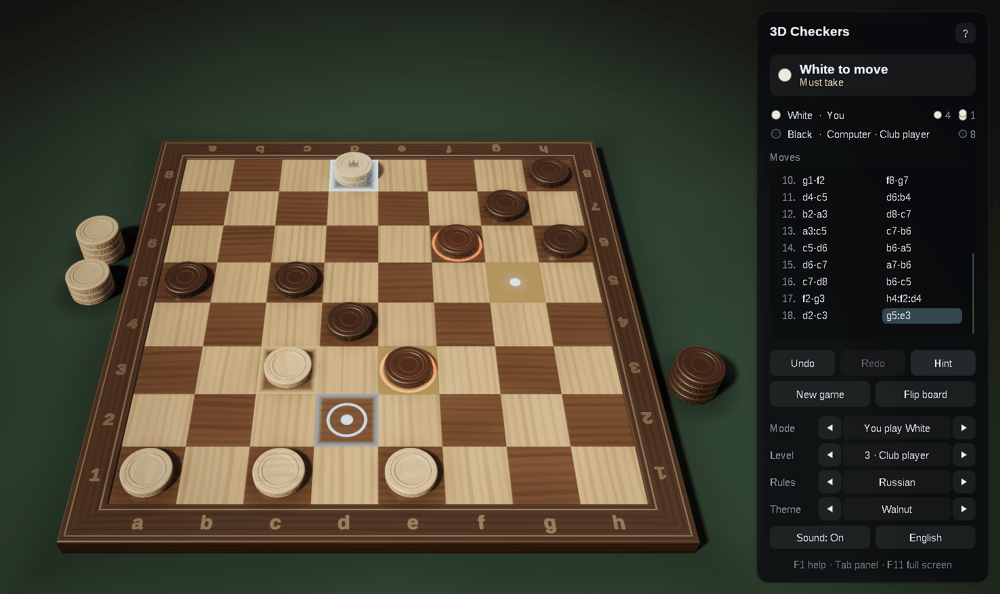
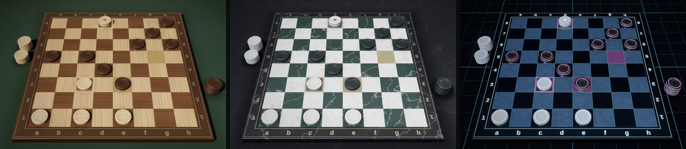

# 3D Checkers — Rust and OpenGL 4.6

[](https://github.com/sponsors/makarov-mm)
[](LICENSE)


[](https://www.linkedin.com/in/makarov-mm/)
[](https://www.threads.net/@m.m.makarov)
[](https://www.instagram.com/m.m.makarov/)

A 3D draughts game written in Rust on OpenGL 4.6, with Russian draughts, English draughts (checkers) and giveaway: the Rust version of the C++ game, with the same rules, computer player, graphics and interface.

There is no game engine, and no model, texture or sound file: the pieces are turned on a lathe in code at startup, the materials are procedural, the lighting environment is baked on the GPU, and the sounds are synthesized. The shaders are built into the executable, so the game is a single file.





## Features

### Rules

- **Russian draughts** (the default): men move forward and take forwards and backwards, kings fly along the diagonals, a man crowned in the middle of a capture goes on taking as a king, White begins
- **English draughts**: men move and take forwards only, kings move one square, a crowning ends the move, Black begins
- **Giveaway** on the Russian rules: the side that loses all its pieces, or is left without a move, wins
- Taking is compulsory; a capture goes on while anything can be taken; a piece taken stays on the board until the capture is over and cannot be jumped twice (the "Turkish strike")
- Draws by threefold repetition, by 15 moves (40 in English draughts) made with kings only and nothing taken, and a king against a king

### Play

- A computer opponent with five levels, from Beginner to Master: iterative deepening, principal variation search, a transposition table, late move reductions, killer and history heuristics, and every capture followed to the end. It thinks on a thread of its own, so the window stays responsive
- Play White, play Black, two players on one computer, or watch the computer play itself
- Move by clicking or by dragging the pieces. The pieces that must take are marked; hovering over a square shows which pieces the move would take; when several captures end on the same square, the route is chosen square by square
- Undo and redo, the move list in Russian or numbered notation, the men and kings each side has left
- Hints: an arrow follows the whole route of the suggested move
- Copy the game as PDN or the position as a PDN FEN, and paste a PDN game or position to continue from it
- The game in progress and the settings are kept between sessions
- English and Russian interface, chosen from the system language
- Sound effects, full screen, awareness of the screen's scale, a dark title bar
- No work while nothing moves: the game waits for input instead of drawing the same picture

### Graphics

- Physically based shading: GGX highlights, a clear lacquer coat, soft light inside the pieces, image-based lighting from a procedural studio environment
- Soft shadows (PCSS), contact shadows, and the pieces reflected in the polished board
- HDR rendering with 4× MSAA, bloom, ACES tone mapping, vignette and dithering
- Smooth edges everywhere: multisampling for the outlines, and the edges of the squares, the joints and the lines drawn by the shaders filtered over each pixel; highlights widen where the surface curves within a pixel, so they do not sparkle
- Pieces turned on a lathe, with grooves round the side and rings on top; a king is two pieces stacked, with a crown inlaid on top
- Animation: the pieces glide and hop over the pieces they take, the pieces taken glow and fly to neat piles beside the board, the crown drops into place, and a new game dissolves in
- Three themes: Walnut, Marble and Neon
- An interface of frosted-glass panels, sharp at any screen scale

## Controls

| Action | Control |
|---|---|
| Move a piece | Click it, then where it goes — or drag it |
| Choose a capture route | Click the squares on the way; `Esc` steps back |
| Turn the view | Right drag, or drag beside the pieces |
| Zoom | Mouse wheel |
| Take back / replay a move | `Ctrl+Z` / `Ctrl+Y`, `←` / `→`, `Backspace` |
| Hint | `H` |
| New game | `N` |
| Flip the board | `F` |
| View from above | `V` |
| Reset the view | `Home` |
| Computer level | `1` … `5` |
| Who plays whom | `M` |
| Rules: Russian, English, giveaway | `R` (`Shift+R` back) |
| Next theme | `T` (`Shift+T` back) |
| Sound on / off | `S` |
| English / Russian | `L` |
| Show / hide the panel | `Tab` |
| Full screen | `F11`, `Alt+Enter` |
| Copy the game (PDN) / position (FEN) | `Ctrl+C` / `Ctrl+Shift+C` |
| Paste a PDN game or position | `Ctrl+V` |
| Help | `F1` |
| Leave full screen, deselect | `Esc` |

## Requirements

- Windows 10 or 11, or Linux (X11 or Wayland), x64
- A graphics card and driver with OpenGL 4.6 (4.5 is enough)
- Rust 1.85 or later (the 2024 edition); on Linux also the ALSA development files (`libasound2-dev` on Debian and Ubuntu)

## Building and running

```sh
cargo run --release
```

The executable is `target/release/checkers3d` (`checkers3d.exe` on Windows) and runs on its own. The settings and the game in progress are kept in `Checkers3D.ini`, in `%APPDATA%\Checkers3D` on Windows and in `$XDG_CONFIG_HOME/Checkers3D` (`~/.config/Checkers3D`) on Linux.

## Project structure

```text
.
├── assets/                Checkers3D.ico
├── shaders/               GLSL shaders, built into the executable
├── src/
│   ├── main.rs            entry point
│   ├── app.rs             game flow, input and interface
│   ├── app/
│   │   ├── window.rs      the window, its events and the frame loop
│   │   └── widgets.rs     the panel, buttons, selectors and notes of the interface
│   ├── draughts.rs        rules of the three variants: move generation, notation, PDN, the game record
│   ├── engine.rs          the computer player: search and evaluation
│   ├── piece_models.rs    the piece turned on a lathe
│   ├── board_geometry.rs  meshes of the board, its frame, the table and the hint arrow
│   ├── board_view.rs      the pieces on the board, their animation and the piles of pieces taken
│   ├── camera.rs          orbit camera and mouse rays
│   ├── renderer.rs        the rendering pipeline
│   ├── themes.rs          materials and lighting of the themes
│   ├── gfx.rs             OpenGL objects and calls behind safe wrappers
│   ├── text.rs            font atlases drawn from the system's fonts
│   ├── ui.rs              drawing of the interface
│   ├── sound.rs           synthesized sound effects
│   ├── settings.rs        the settings file
│   ├── strings.rs         English and Russian texts
│   ├── shaders.rs         the shader sources built into the executable
│   ├── platform.rs        the window's OpenGL context, the settings folder, the system language, the icon
│   └── math.rs            vectors and matrices
├── build.rs               the icon and version information of the Windows executable
└── Cargo.toml
```

## Dependencies

| Crate | For |
|---|---|
| `winit` | the window and its input |
| `glutin`, `glutin-winit`, `raw-window-handle` | the OpenGL context |
| `gl` | the OpenGL functions |
| `fontdb`, `fontdue` | finding the system's fonts and drawing their glyphs |
| `cpal` | sound output |
| `arboard` | the clipboard |
| `sys-locale` | the system language |
| `png` (Linux) | the window's icon |
| `winresource` (build) | the icon and version information of the Windows executable |

## How a frame is drawn

1. **Shadow map** — the pieces seen from the key light, for soft shadows.
2. **Reflection** — the pieces mirrored under the board, drawn at half resolution and blurred into mipmaps, so the polish of each theme can show a sharper or softer reflection.
3. **Main pass** — the table, the board and the pieces in HDR with 4× MSAA, lit by the key light and the baked environment; the background is the environment itself.
4. **Post-processing** — the samples are resolved, bright parts spread into a six-level bloom, and the composite pass applies tone mapping and vignetting and frosts the glass behind the interface panels.
5. **Interface** — panels, text and icons, drawn on top.

The environment maps are baked with compute shaders when the theme changes, and the BRDF table once at startup.

## License

MIT License

Copyright (c) 2026 Mykhailo Makarov

Permission is hereby granted, free of charge, to any person obtaining a copy
of this software and associated documentation files (the "Software"), to deal
in the Software without restriction, including without limitation the rights
to use, copy, modify, merge, publish, distribute, sublicense, and/or sell
copies of the Software, and to permit persons to whom the Software is
furnished to do so, subject to the following conditions:

The above copyright notice and this permission notice shall be included in all
copies or substantial portions of the Software.

THE SOFTWARE IS PROVIDED "AS IS", WITHOUT WARRANTY OF ANY KIND, EXPRESS OR
IMPLIED, INCLUDING BUT NOT LIMITED TO THE WARRANTIES OF MERCHANTABILITY,
FITNESS FOR A PARTICULAR PURPOSE AND NONINFRINGEMENT. IN NO EVENT SHALL THE
AUTHORS OR COPYRIGHT HOLDERS BE LIABLE FOR ANY CLAIM, DAMAGES OR OTHER
LIABILITY, WHETHER IN AN ACTION OF CONTRACT, TORT OR OTHERWISE, ARISING FROM,
OUT OF OR IN CONNECTION WITH THE SOFTWARE OR THE USE OR OTHER DEALINGS IN THE
SOFTWARE.

## Support

If you found this project interesting or useful, you can support my work:

[](https://github.com/sponsors/makarov-mm)
